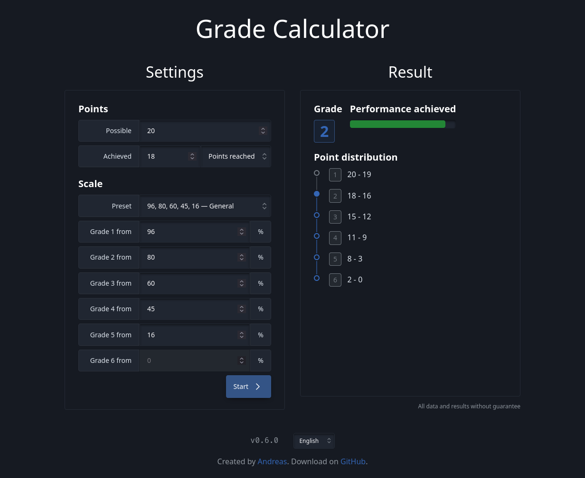

# Grade Calculator

A web app to calculate an achieved grade based on reached points and grade scale. Based on Vue.js and [Sloth.css](https://github.com/devmount/sloth.css).

## Demo



<https://grades.devmount.de>

## Features

- Different scales can be configured
- Display of grade and position in scale

## Get started

1. Get all files

    ```bash
    git clone https://github.com/devmount/grade-calculator
    ```

2. Install all dependencies

    ```bash
    cd grade-calculator
    pnpm install
    ```

3. Either start the development server with hot reload at localhost:5173 ...

    ```bash
    pnpm run dev
    ```

4. ... or create a production build with minification

    ```bash
    pnpm run build
    ```
